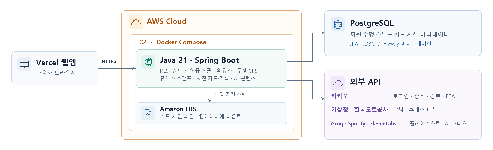
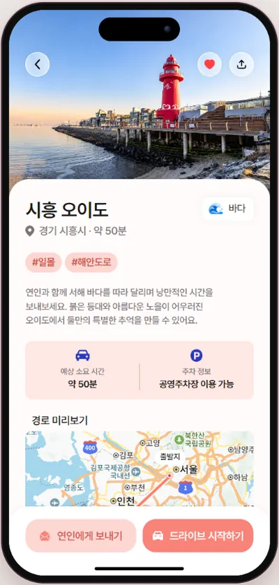
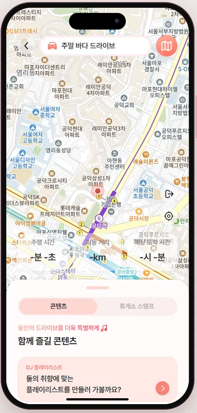
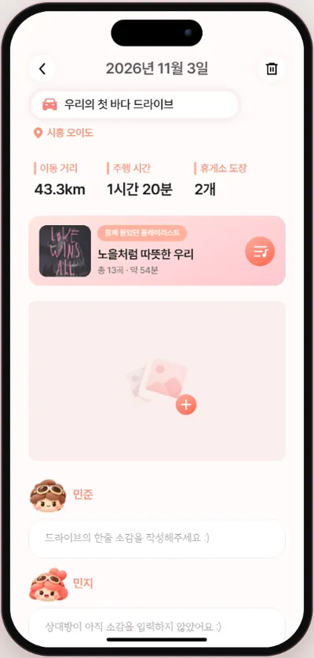
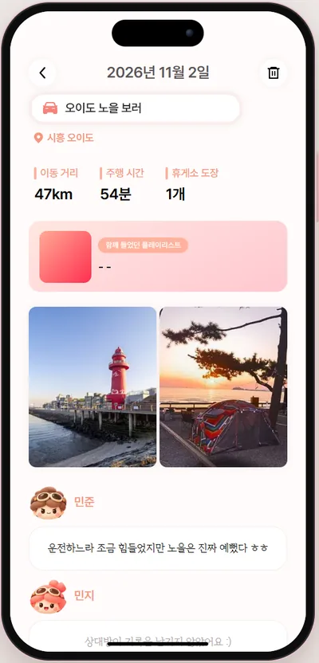
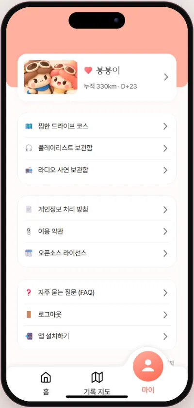

# 🚗 붕붕어스 (BoongBoongUs) BE

- 서비스: [붕붕어스 웹앱](https://2026-line4thon-team6-fe.vercel.app/)
- 프론트엔드 저장소: [2026-line4thon-team6-FE](https://github.com/2026-line4thon-team6/2026-line4thon-team6-FE)
- API 명세: [OpenAPI YAML](docs/api/openapi.yaml)
- 협업 규칙: [CONTRIBUTING.md](CONTRIBUTING.md)

## 프로젝트 소개

붕붕어스는 연인과 함께하는 드라이브를 준비부터 기록까지 이어 주는 모바일 웹 서비스입니다. 목적지를 고르고 드라이브를 시작해 휴게소 도장을 모을 수 있고, 주행 중에는 DJ 플레이리스트, AI 라디오, 커플 게임을 즐길 수 있습니다. 도착하면 사진과 한 줄 소감을 드라이브 카드에 남기고, 다녀온 곳을 기록 지도와 캘린더에서 다시 볼 수 있습니다.

## 팀원 구성 (BE)

| 팀원 | 담당 |
| --- | --- |
| [@handdongmin](https://github.com/handdongmin) | 홈·장소, 경로·주행·GPS, 휴게소·스탬프, 사진·카드·기록, PostgreSQL 관리 |
| [@lsw88711087-web](https://github.com/lsw88711087-web) | 공통·운영, 인증·회원, 커플·기기, 알림, AI 작업·플레이리스트·라디오·게임, 백엔드 배포 |

## 1. 서비스 구성과 개발 환경



하나의 Spring Boot 애플리케이션에서 도메인별 API를 제공합니다. 회원·주행·스탬프·카드와 사진 메타데이터는 PostgreSQL에, 카드 사진 파일은 EC2에 연결한 EBS에 저장합니다. 그림의 PostgreSQL 박스는 연결 관계를 나타내며, 운영 DB의 호스팅 위치는 표시하지 않습니다.

**기술 스택:** Java 21 · Spring Boot 4.1.2 · Spring Data JPA/JDBC · PostgreSQL 18 · Flyway · Gradle Wrapper 9.8.2 · Docker

## 2. 기술 선택과 설계

- **Spring Boot · JPA/JDBC:** 기능을 도메인별로 나누고, 요청 검증과 트랜잭션 경계를 서버에서 관리합니다.
- **PostgreSQL · Flyway:** 커플, 주행, 카드처럼 연결된 데이터를 한 DB에서 관리하며, 스탬프 중복 적립은 DB 제약으로 막습니다. DB 변경은 버전이 매겨진 SQL로 적용합니다.
- **Docker · GitHub Actions:** 같은 이미지로 실행 환경을 재현하고, PostgreSQL 통합 테스트를 통과한 변경을 EC2에 배포합니다.

## 3. 주요 기능

| 기능 | 제공 범위 |
| --- | --- |
| 인증·커플 | 카카오 로그인, 회원 프로필·탈퇴, 초대 코드, 커플 연결·해제·복구 |
| 알림 | 인앱 알림, 설정된 웹 기기 대상 Web Push |
| 홈·장소 | 날씨, 추천 장소, 키워드 검색, 주소 변환, 주변 주차장, 장소 찜·공유 |
| 경로·주행 | 자동차 경로와 교통 요약, 주행 시작·일시정지·종료, GPS 기록과 예상 도착시간 갱신 |
| 휴게소·스탬프 | 경로 주변 휴게소, 메뉴 상세, 접근 알림, GPS 방문 검증 및 도장판 |
| 카드·기록 | 사진 업로드, 커플 소감, 카드 작성·공유, 기록 목록·지도·캘린더 |
| 드라이브 콘텐츠 | DJ 플레이리스트 추천·주행 연결·보관, AI 라디오 대본·음성, 커플 게임 |

주행 중 만든 플레이리스트는 요청에 `driveId`가 있으면 해당 주행에 연결합니다. 주행 조회는 연결된 최신 플레이리스트를 반환하고, 카드의 플레이리스트 요약이 비어 있으면 카드에도 그 결과를 반영합니다.

### 서비스 화면

백엔드 API가 쓰이는 화면입니다. 캡처는 [프론트엔드 README](https://github.com/2026-line4thon-team6/2026-line4thon-team6-FE/blob/main/README.md)에서 가져왔습니다.

| 홈 | 장소 상세 | 미작성 카드 |
| :---: | :---: | :---: |
|  |  |  |

| 주행 | 드라이브 카드 | 기록 상세 |
| :---: | :---: | :---: |
|  |  |  |

| 기록 지도 | 기록 목록 |
| :---: | :---: |
|  |  |

| 알림 | 마이 | 커플 |
| :---: | :---: | :---: |
|  |  |  |

## 4. 신경 쓴 부분

- **GPS로 방문 확인:** 서버가 기록 담당자의 GPS를 검증해 방문 증거가 있는 경우에만 스탬프를 지급합니다. 경로 위 표시와 스탬프 지급은 각각 별도로 판단합니다.
- **재시도와 동시 요청:** 일부 쓰기 API는 `Idempotency-Key`로 같은 요청의 중복 처리를 막습니다. 주행이나 카드처럼 여러 사람이 수정할 수 있는 데이터는 버전을 확인합니다.
- **사진 접근 제어:** 실제 파일은 EBS에 두고, 조회·업로드에는 만료 시간이 있는 서명 URL을 사용합니다. URL이 만료되면 상세 API 등을 통해 새 링크를 발급받아야 합니다.
- **외부 API 장애 대응:** 도로공사에서 메뉴를 받지 못하면 DB에 저장한 목록을 유지합니다. Web Push는 알림 저장 후 비동기로 보내므로 발송에 실패해도 인앱 알림은 남습니다.

## 5. 로컬 실행

JDK 21과 Docker Compose가 필요합니다. 저장소 루트에서 [`.env.example`](.env.example)을 `.env`로 복사하고 `DB_PASSWORD`를 설정한 뒤 실행합니다. 이미 `.env`가 있다면 필요한 값만 수정합니다.

**Windows PowerShell**

```powershell
Copy-Item .env.example .env
# .env에 DB_PASSWORD 설정
docker compose up -d --wait postgres
.\gradlew.bat bootRun
```

**macOS / Linux**

```bash
cp .env.example .env
# .env에 DB_PASSWORD 설정
docker compose up -d --wait postgres
./gradlew bootRun
```

기본 프로필은 `local`이고 서버 포트는 `8080`입니다. 기존 PostgreSQL을 사용하려면 Compose 실행을 생략하고 `.env`의 `DB_HOST`, `DB_PORT`, `DB_NAME`, `DB_USERNAME`, `DB_PASSWORD`를 맞춥니다. Compose의 PostgreSQL 데이터는 `postgres-data` 볼륨에 보존되며, 초기 계정 설정은 빈 볼륨을 처음 시작할 때 적용됩니다.

| 주소 | 용도 |
| --- | --- |
| [`/api/v1/health`](http://localhost:8080/api/v1/health) · [`/actuator/health`](http://localhost:8080/actuator/health) | API 응답 및 서버 상태 확인 |
| [`/api/v1/app-config`](http://localhost:8080/api/v1/app-config) | 앱 정책, 제한값, 기능 플래그 확인 |
| [`/swagger-ui.html`](http://localhost:8080/swagger-ui.html) · [`/v3/api-docs`](http://localhost:8080/v3/api-docs) | 실행 중인 서버의 API 문서와 OpenAPI JSON |

### 기능별 환경 변수

기능을 확인할 때 필요한 항목만 설정합니다. 실제 키와 비밀번호는 `.env`나 배포 환경에 보관합니다.

| 기능 | 설정 |
| --- | --- |
| 카카오 로그인 | `KAKAO_LOGIN_REST_API_KEY`, `KAKAO_LOGIN_REDIRECT_URIS`, `AUTH_TOKEN_KEY`. Client Secret을 사용하면 `KAKAO_LOGIN_CLIENT_SECRET`, 카카오 연결 해제에는 `KAKAO_LOGIN_ADMIN_KEY`가 필요합니다. |
| 장소 검색·길찾기 | 카카오 로컬 `KAKAO_LOCAL_REST_API_KEY`, 카카오모빌리티 `KAKAO_MOBILITY_REST_API_KEY` |
| 홈 날씨 | 기상청 `KMA_SERVICE_KEY` |
| 휴게소 메뉴 자동 갱신 | [한국도로공사 인증키](https://data.ex.co.kr/openapi/apikey/requestKey)를 `EX_REST_AREA_API_KEY`에 설정 |
| 사진 저장·공유 | `MEDIA_STORAGE_ROOT`, `MEDIA_PUBLIC_BASE_URL`, `MEDIA_SIGNING_KEY`. 장소·카드 공유 링크는 `PLACE_SHARE_BASE_URL`, `CARD_SHARE_BASE_URL`로 설정합니다. |
| Web Push | `WEB_PUSH_VAPID_PUBLIC_KEY`, `WEB_PUSH_VAPID_PRIVATE_KEY`, `WEB_PUSH_SUBJECT`. 키가 비어 있으면 인앱 알림만 제공하며, 공개키는 프론트 `VITE_WEB_PUSH_PUBLIC_KEY`와 맞춥니다. |
| DJ·AI 라디오 | `GROQ_API_KEY`, `SPOTIFY_CLIENT_ID`, `SPOTIFY_CLIENT_SECRET`, `ELEVENLABS_API_KEY` |

- 카카오 콜백 주소는 카카오 개발자 콘솔에 등록한 주소와 정확히 일치해야 합니다. `AUTH_TOKEN_KEY`는 무작위 32바이트 이상을 Base64로 인코딩한 값입니다. 약관과 FAQ는 [약관 설정](src/main/resources/legal-documents.yml)과 [FAQ 설정](src/main/resources/faqs.yml)에서 관리합니다. 주행 시작에는 기록 사용자의 `PRIVACY v1` 동의가 필요합니다.
- 휴게소 메뉴는 Flyway가 넣은 초기 데이터로도 조회할 수 있습니다. 키를 설정하면 앱 시작 약 10초 뒤와 이후 24시간마다 도로공사 데이터를 가져옵니다. 대표 → 추천 → 일반 순으로 이름을 최대 4개 저장하며, 조회 실패 시 저장된 메뉴를 유지합니다.
- 운영 사진 저장 디렉터리는 EBS에 만들고 앱 실행 계정에 쓰기 권한을 부여합니다. 컨테이너에 마운트한 경로를 `MEDIA_STORAGE_ROOT`로 설정합니다. `MEDIA_PUBLIC_BASE_URL`은 브라우저에서 접근할 수 있는 API 기본 주소이고, `MEDIA_SIGNING_KEY`는 무작위 32바이트 이상의 서명 키입니다.

## 6. API 문서

[OpenAPI YAML](docs/api/openapi.yaml)이 프론트엔드와 공유하는 설계 계약의 원본입니다. [문서 뷰어](docs/api/index.html)를 로컬 브라우저에서 열면 **로컬 YAML 열기**로 같은 폴더의 `openapi.yaml`을 선택할 수 있습니다. 뷰어가 Swagger UI를 불러오려면 인터넷 연결이 필요합니다.

실제로 구현된 엔드포인트는 실행 중인 로컬 서버의 Swagger UI에서 확인합니다. 운영에서는 Swagger UI와 런타임 OpenAPI를 비활성화합니다. API 수정 시 구현과 OpenAPI 계약을 함께 갱신합니다.

- 공통 경로 접두사는 `/api/v1`입니다. 보호된 API는 `Authorization: Bearer <accessToken>`을 사용합니다.
- 성공 응답은 `{data, meta}`, 오류 응답은 `{error, meta}`입니다. `204` 응답에는 본문이 없습니다.
- 요청 추적에는 `X-Request-Id` 또는 `meta.requestId`를 사용합니다. `X-Couple-Id`, `Idempotency-Key` 등의 필수 조건은 엔드포인트별 명세에 따릅니다.

## 7. 테스트·배포와 작업 관리

```powershell
.\gradlew.bat clean build
```

macOS/Linux에서는 `./gradlew clean build`를 실행합니다. 로컬 자동 테스트는 기본 H2를 사용하고, [GitHub Actions CI](.github/workflows/ci.yml)는 실제 PostgreSQL 18로 빌드와 테스트를 실행합니다. 테스트 보고서는 `build/reports/tests/test/index.html`에서 확인할 수 있습니다.

`main` 빌드가 통과하면 [배포 워크플로](.github/workflows/deploy.yml)가 Docker 이미지를 ECR에 올리고, AWS Systems Manager(SSM)로 [EC2 배포 스크립트](scripts/deploy-ec2.sh)를 실행합니다. EC2는 새 이미지를 받아 Docker Compose로 앱을 교체한 뒤 상태 확인을 수행합니다.

운영은 `prod` 프로필을 사용합니다. EC2의 `app.env`에서 DB 접속 정보, `CORS_ALLOWED_ORIGINS`, 외부 API 키를 Compose를 통해 앱 컨테이너에 전달합니다. Flyway는 앱 시작 시 [마이그레이션](src/main/resources/db/migration)을 적용하며, 기존 DB의 적용 이력과 새 버전의 순서를 배포 전에 확인합니다.

일반 기능 PR은 `develop`에서 검토하고, `main`은 운영 배포 기준으로 사용합니다. 이슈와 PR은 저장소 템플릿을 사용합니다.

## 8. 트러블 슈팅

| 증상 | 확인할 항목 |
| --- | --- |
| 새 추천 장소가 운영 화면에 보이지 않음 | 변경이 `main`에 반영됐는지, 해당 커밋의 배포가 성공했는지 확인합니다. |
| 메뉴가 초기 대표메뉴에서 갱신되지 않음 | `EX_REST_AREA_API_KEY`가 앱 컨테이너에 전달됐는지와 서버의 메뉴 갱신 로그를 확인합니다. |
| Flyway가 누락된 버전을 보고함 | 실제 DB에 적용된 이력과 두 브랜치의 변경 순서를 먼저 대조합니다. 이미 적용된 파일은 수정하지 않습니다. |

## 9. 프로젝트 구조

| 경로 | 역할 |
| --- | --- |
| [`domain/`](src/main/java/com/boongboongus/backend/domain) | 인증, 커플, 홈, 주행, 카드, 미디어 등 기능별 코드 |
| [`common/`](src/main/java/com/boongboongus/backend/common) · [`config/`](src/main/java/com/boongboongus/backend/config) | 공통 응답·오류·요청 추적, CORS 및 API 설정 |
| [`docs/api/`](docs/api) | OpenAPI 계약과 문서 뷰어 |
| [`src/test/`](src/test) | 단위 테스트와 API·DB 통합 테스트 |

브랜치, 이슈, PR 작성 방식은 [CONTRIBUTING.md](CONTRIBUTING.md), AI 작업 지침은 [AGENTS.md](AGENTS.md)를 참고합니다.
